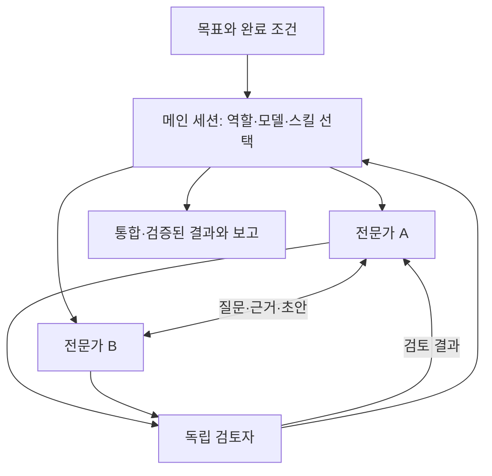

# Orchestrator Kit for Codex and Claude Code

[English](README.md) | 한국어

**Codex와 Claude Code에서 함께 쓰는 전문가 팀 오케스트레이션 스킬입니다. 과업에 필요한 전문가·모델·스킬을 고르고, 서로의 작업을 검토하게 한 뒤, 통합 결과를 직접 검증하고 보고합니다.**

개발, 조사, 사업 분석, 데이터, 문서, 콘텐츠, 업무 운영을 다루는 역할 35개(Claude Code는 33개)를 팩 단위로 설치할 수 있습니다. Codex에는 `$orchestrate` 스킬과 커스텀 에이전트를, Claude Code에는 `/orchestra:orchestrate` 스킬·역할 서브에이전트·Workflow 스크립트 2개가 든 `orchestra` 플러그인을 제공합니다. 저장소는 `yoyowasi/codex-orchestrator-kit`입니다. 개인 프로젝트이며 OpenAI나 Anthropic의 공식 제품이 아닙니다.

## 하는 일



메인 세션이 총괄입니다. 목표를 정리하고, 카탈로그에서 역할을 고르거나 과업용 역할을 정의하고, 배정마다 모델과 추론 수준을 정하고, 설치된 스킬을 연결하고, 파일 담당을 나눕니다. 동료끼리는 검토 결과를 직접 주고받고, 총괄은 실제 산출물을 확인해 검증한 것과 못 한 것을 구분해 보고합니다. 운영 데이터 쓰기, 배포, 게시, 외부 발신, 권한 변경 같은 승인 대상 작업은 전문가가 스스로 실행하지 않고 승인 요청으로 돌려보냅니다. 사용자가 승인하면 총괄이 승인된 작업만 직접 실행하거나, 승인 범위를 적어 전문가에게 맡깁니다. 승인은 승인한 작업·대상·범위에만 적용되고 그 밖으로 넓어지지 않습니다.

**팀을 만들지 않는 경우.** 파일 하나만 고치거나 도구 호출 10번 정도 이하로 끝나는 작업, 각 단계가 앞 단계 결과에 의존하는 작업, 간단한 질문·조회, 여러 작업자가 같은 파일을 고쳐야 하는 작업, 직접 해 달라는 요청은 혼자 처리하고 그 이유를 한 줄로 밝힙니다. 팀을 명시적으로 요청하면 팀을 만들되 최소 인원으로 구성합니다.

## 빠른 시작: Claude Code

Claude Code 세션에서 실행합니다.

```text
/plugin marketplace add yoyowasi/codex-orchestrator-kit
/plugin install orchestra@codex-orchestrator-kit
/reload-plugins
```

`orchestra`는 스킬, 핵심 역할, Workflow 스크립트가 든 기본 플러그인입니다. 자주 쓸 팩을 추가하고 `/reload-plugins`를 다시 실행합니다.

```text
/plugin install orchestra-dev@codex-orchestrator-kit
/plugin install orchestra-business@codex-orchestrator-kit
```

명시적으로 호출하거나 그냥 작업을 설명하면 됩니다.

```text
/orchestra:orchestrate 이 프로젝트에 회원가입과 로그인을 추가해줘. 필요한 전문가와 모델을 고르고 파일 담당을 나눠 구현·검토·검증까지 진행해줘.
```

설치하지 않은 팩의 역할도 쓸 수 있습니다. 총괄이 범용 에이전트에 해당 역할 지침을 붙여 실행합니다. 업데이트, 제거, 스크립트 설치, 손으로 복사한 에이전트 파일 정리는 [docs/claude-code.md](docs/claude-code.md)에 있습니다(영문).

## 빠른 시작: Codex

**스킬만 설치.** Codex에 요청합니다.

```text
$skill-installer install https://github.com/yoyowasi/codex-orchestrator-kit/tree/main/skills/orchestrate
```

스킬이 보이지 않으면 Codex를 다시 시작합니다. 커스텀 에이전트를 등록하지 않고 `config.toml`도 바꾸지 않습니다. 총괄이 기본 에이전트에 역할 지침을 붙여 넣으므로 모든 역할을 그대로 쓸 수 있습니다.

**스킬, 역할 등록, 동시 실행 상한까지 설치.** Python 3.11 이상이 필요합니다. `python`이 3.11 미만이면 Windows는 `py -3`, macOS/Linux는 `python3`를 씁니다.

```sh
git clone https://github.com/yoyowasi/codex-orchestrator-kit.git
cd codex-orchestrator-kit
python scripts/install.py                       # 스킬 + core 역할
python scripts/install.py --packs dev,business  # core + 지정한 팩(유지할 팩을 모두 적음)
python scripts/install.py --packs all           # codex-only를 포함한 모든 팩
```

설치기는 스킬을 `~/.agents/skills/orchestrate`에, 선택한 팩의 역할을 `$CODEX_HOME/agents`(기본 `~/.codex`)에 복사하고, `config.toml`에 상한이 없으면 `[agents] max_concurrent_threads_per_session = 12`를 넣습니다. `config.toml`이 이미 있는데 상한이 없으면 첫 실행은 충돌로 멈춥니다. `--force`로 다시 실행하면 백업한 뒤 설정을 추가합니다. `--dry-run`으로 충돌을 포함한 계획을 미리 확인할 수 있습니다. 전체 옵션은 [docs/codex.md](docs/codex.md)에 있습니다(영문).

프로젝트에서 이렇게 요청합니다.

```text
$orchestrate 이 프로젝트에 회원가입과 로그인을 추가해줘. 필요한 전문가와 모델을 고르고 파일 담당을 나눠 구현·검토·검증까지 진행해줘.
```

## 팩

| 팩 | Claude Code 플러그인 | 역할 |
|---|---|---|
| `core`(항상 설치) | `orchestra` | researcher, architect, frontend-developer, backend-developer, qa-engineer, reviewer, security-reviewer, evidence-reviewer, technical-writer |
| `dev` | `orchestra-dev` | database-engineer, devops-engineer, performance-engineer, automation-engineer, ux-designer, accessibility-auditor |
| `docs` | `orchestra-docs` | data-analyst, document-producer, pdf-specialist, spreadsheet-modeler, presentation-designer, visual-creator |
| `business` | `orchestra-business` | business-analyst, financial-modeler, product-manager, user-insights-analyst, operations-designer, app-operator |
| `content` | `orchestra-content` | content-strategist, creative-writer, localization-editor, learning-designer |
| `agent-dev` | `orchestra-agent-dev` | skill-author, plugin-developer |
| `codex-only` | 없음(Codex 전용) | openai-solution-designer, sites-builder |

실행 시 이름: Claude Code 플러그인 에이전트는 `orchestra:<id>` 또는 `orchestra-<pack>:<id>`(스크립트 설치는 `<id>`), Codex 역할은 밑줄 표기(`evidence_reviewer`)입니다. 읽기 전용 역할은 architect, evidence-reviewer, accessibility-auditor, user-insights-analyst, openai-solution-designer이고, 읽기+셸 역할(테스트 실행 가능, 수정 금지 지시)은 reviewer, security-reviewer입니다. 실제로 무엇이 강제되는지는 [한계](#한계)를 보세요.

## 요청 예시

Claude Code에서는 `/orchestra:orchestrate`, Codex에서는 `$orchestrate`를 앞에 붙이거나, 그냥 팀으로 진행해 달라고 요청합니다.

```text
공개 API에 키별 요청 제한(분당 100회)을 추가하고, 병합 전에 보안 검토를 따로 받아줘.
배포는 하지 마.
```

```text
지난주부터 야간 데이터 적재가 세 배 느려진 원인을 찾아줘. 읽기 전용으로,
근거와 함께 원인과 수정 계획만 보고하고 코드는 바꾸지 마.
```

```text
첨부한 고객 의견과 비용 자료로 사업 제안서를 만들어줘. 사용자 인사이트, 재무 시나리오,
문서 작성을 나누고 모든 수치를 따로 검증해줘.
```

```text
온보딩 가이드를 일본어와 독일어로 현지화하고 용어집을 일관되게 유지해줘.
표현을 결정한 내역도 정리해줘.
```

## 협업 방식

- **Claude Code.** 메인 세션이 Agent 도구로 이름 붙인 서브에이전트를 만들고, 이름이 있는 동료끼리 SendMessage로 직접 소통합니다. git 저장소에서 여러 작업자가 동시에 코드를 쓰면 각자 워크트리를 줄 수 있습니다. `/orchestra:team-review`(각 지적이 반박 시도를 통과해야 하는 읽기 전용 코드 리뷰)와 `/orchestra:team-research`(모든 주장을 출처와 대조하는 조사)는 정해진 단계로 도는 Workflow 스크립트이며 요청할 때만 씁니다. 에이전트 팀(`CLAUDE_CODE_EXPERIMENTAL_AGENT_TEAMS=1`)을 켜 두었다면 이름 붙인 에이전트가 팀원으로 시작합니다. 자세한 내용: [docs/claude-code.md](docs/claude-code.md).
- **Codex.** 세션의 멀티 에이전트 도구(`spawn_agent`, `send_message`/`followup_task` 또는 `send_input`, `wait_agent`)를 씁니다. 등록된 역할은 `agent_type`으로 지정하고, 등록되지 않은 역할은 기본 에이전트에 역할 지침을 붙여 넣습니다. `$orchestrate`로 직접 호출하면 배정마다 `model`과 `reasoning_effort`를 고르고 재조정합니다. Codex가 스킬을 자동 선택한 경우에는 허용된 때만 지정합니다. 자세한 내용: [docs/codex.md](docs/codex.md).

## 한계

| 항목 | Claude Code | Codex |
|---|---|---|
| `read-only` 역할 | 설치된 역할 에이전트는 강제됨: 허용 도구가 Read, Grep, Glob, WebFetch, WebSearch, SendMessage뿐(셸·MCP 도구 없음). 범용 에이전트에 역할 지침을 붙여 실행하면 지시 수준 | 권고 수준: 역할 파일에 `sandbox_mode = "read-only"`가 있지만, 현재 Codex 소스에서는 하위 에이전트가 부모 세션 권한을 그대로 물려받음 |
| `read-shell` 역할 | 부분적: Write, Edit, NotebookEdit는 막히지만 Bash·PowerShell이 남아 있어 "파일 수정 금지"는 지시 수준 | 권고 수준(위와 같음) |
| `write` 역할 | 배정에 적은 파일 담당만 적용 | 같음 |
| 중첩 팀 금지 | 모든 역할에서 Agent 도구 제거. 범용 대체 에이전트는 생성 깊이를 제한하지 않으면 Agent 도구를 가짐 | 지시 수준(v2는 깊이 제한 없음) |
| 설치 방식 | 플러그인과 `install.py --target claude` 중 하나만 사용. 둘 다 같은 스킬과 에이전트를 등록함 | `$skill-installer`(`~/.codex/skills/orchestrate`)와 `install.py`(`~/.agents/skills/orchestrate`) 중 하나만 사용. 서로 다른 폴더에 쓰므로 둘 다 쓰면 스킬이 두 번 등록됨 |
| 제거 | 플러그인 제거 또는 `install.py --target claude --uninstall` | `install.py --uninstall`은 기록된 파일 중 바뀌지 않은 것만 지우고 `config.toml` 상한은 남김 |
| 비용 | 전문가, 워크플로 단계, 팀원마다 별도 컨텍스트를 쓰므로 혼자 작업할 때보다 토큰을 훨씬 많이 씀 | 같음 |

## v1에서 업그레이드

**Codex.** v1은 역할 37개를 설치 매니페스트 없이 설치했습니다. 2.0 체크아웃에서 한 번 실행합니다.

```sh
python scripts/install.py --packs all --force
```

v1 파일을 2.0 파일로 교체하고(백업 위치 `$CODEX_HOME/agent-backups/orchestrator-kit-<시각>/`) 이후로는 매니페스트로 관리합니다. `--prune-legacy`를 함께 주면(권장) 2.0에 없는 파일도 백업 후 지웁니다. `agents/`의 `orchestrator.toml`, `template-author.toml`과 스킬 폴더의 예전 `references/roles/*.toml`, `references/workflows.md`가 대상입니다. 이 옵션이 없으면 Codex에 예전 `orchestrator`, `template_author` 역할이 계속 보이고, 설치기는 해당 파일을 `legacy_files`에 표시만 합니다. v1 실행기를 썼다면 `--with-cli`도 추가합니다. 어느 명령이든 `--dry-run`을 붙이면 미리 확인할 수 있습니다. core 역할만 남기려면 대신 `python scripts/install.py --force --prune-legacy`를 실행합니다. v1을 `~/.codex/skills/orchestrate`에 설치했다면 스킬이 두 번 등록되지 않도록 `--skills-dir ~/.codex/skills`를 지정합니다.

**Claude Code.** v1에는 Claude Code 설치 방식이 없었습니다. 파일을 `~/.claude/agents`나 `~/.claude/skills/orchestrate`에 직접 복사했다면 플러그인 설치 전에 백업하고 지우세요. 그대로 두면 모든 역할이 두 번 보입니다. [docs/claude-code.md](docs/claude-code.md#migrating-from-manually-copied-files)를 참고하세요.

**2.0에서 바뀐 점:** 스킬과 역할 본문을 영어로 바꿨습니다(총괄은 여전히 사용자의 언어로 답합니다). 역할은 35개로 팩에 나뉘며 기본 설치는 `core`입니다. `orchestrator` 역할은 없어졌고(메인 세션이 총괄) `template-author`는 `skill-author`에 합쳤습니다. Claude Code 플러그인과 Workflow 스크립트, 매니페스트 기반 업데이트·정리·제거가 추가됐습니다. `codex-team` 실행기는 `extras/codex-team`으로 옮겼고 모델을 설정할 수 있습니다. 전체 목록: [CHANGELOG.md](CHANGELOG.md).

## 저장소 구조

```text
src/                     단일 원본: 매니페스트, 스킬 본문, 역할 정의, 워크플로
scripts/build.py         src/에서 플랫폼별 파일을 모두 생성
scripts/install.py       Codex용, 그리고 플러그인 없는 Claude Code용 설치기
skills/orchestrate/      생성된 Codex 스킬($skill-installer 경로)
codex/agents/            생성된 Codex 커스텀 에이전트
plugins/                 생성된 Claude Code 플러그인(팩마다 하나)
.claude-plugin/          생성된 Claude Code 마켓플레이스
extras/codex-team/       선택 사항인 Windows 여러 창 실행기(Codex 전용)
tests/                   빌드·설치·워크플로 테스트
docs/                    플랫폼별 안내와 생성기 계약
```

생성된 파일은 커밋하지만 손으로 고치지 않습니다. `src/`를 수정한 뒤 `python scripts/build.py`를 실행합니다. 계약은 [docs/architecture.md](docs/architecture.md)에 있습니다.

## 검증

계정이나 모델 호출 없이 실행할 수 있습니다.

```sh
python scripts/build.py --check
python -m unittest discover -s tests -p "test_*.py"
node --check extras/codex-team/codex-team.mjs
node extras/codex-team/team.test.mjs
node tests/workflows.test.mjs
claude plugin validate .    # 선택 사항, Claude Code CLI 필요
```

생성 파일과 원본의 차이, 설치기(팩, 충돌, 백업, 매니페스트, 정리, 설정 편집), 실행기 로직, 워크플로 스크립트 문법을 확인합니다. 모델이 실제로 얼마나 잘 조율하는지는 측정하지 않습니다.

## 선택 사항: codex-team 실행기

[extras/codex-team](extras/codex-team/README.md)은 총괄과 작업자를 각각 별도의 Codex CLI 창으로 엽니다. 선택 사항이며 Windows 전용, Codex 전용, 실험 기능입니다. 스킬은 이 실행기 없이 동작합니다.

## 라이선스

[MIT](LICENSE). Orchestrator Kit for Codex and Claude Code는 OpenAI나 Anthropic의 공식 제품이 아닙니다.
