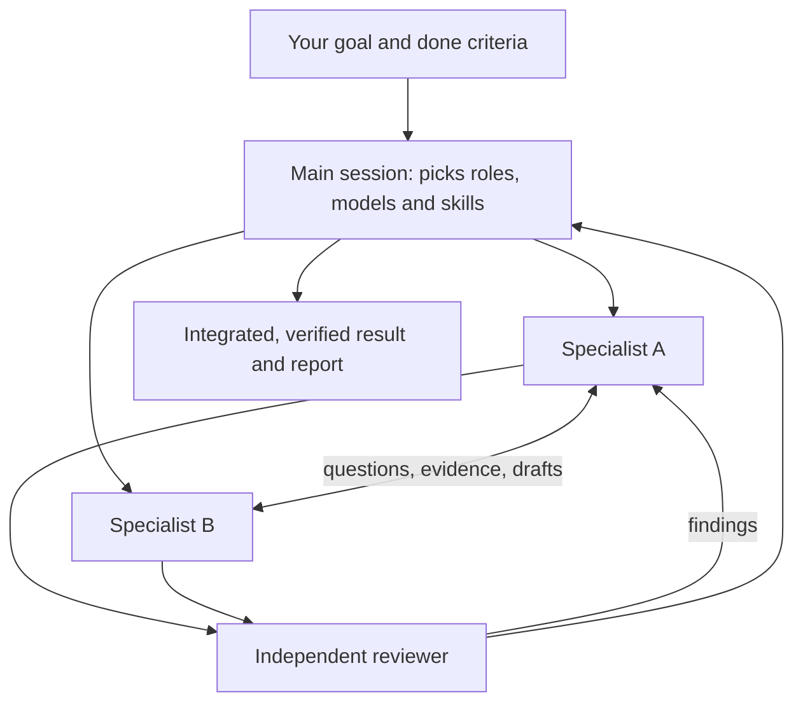

# Orchestrator Kit for Codex and Claude Code

English | [한국어](README.ko.md)

**An expert-team orchestration skill for Codex and Claude Code that picks the specialists, models and skills a task needs, lets them review each other's work, and verifies the integrated result before reporting.**

It ships 35 role definitions (33 on Claude Code) in installable packs, covering software, research, business, data, documents, content and operations. Codex gets the `$orchestrate` skill and custom agents; Claude Code gets the `orchestra` plugins with the `/orchestra:orchestrate` skill, role subagents and two Workflow scripts. It lives in the `yoyowasi/codex-orchestrator-kit` repository. This is a personal project, not an official OpenAI or Anthropic product.

## What it does



Your main session is the orchestrator. It frames the goal, chooses roles from the catalog (or defines one for the task), picks a model and effort per assignment, routes the skills you have installed, assigns owned files, lets peers exchange findings directly, then checks the actual artifacts and reports what was verified and what was not. Specialists never run gated actions (production data writes, deployments, publishing, external messages, permission changes) on their own: they return an approval request, and only after you approve does the orchestrator run the approved action itself or hand it to a specialist with exactly that approval. The approval covers what you approved (action, target, scope) and nothing beyond it.

**When it does not build a team.** It works solo, and says so in one line, when the task is a single-file fix or roughly ten tool calls or fewer, when each step depends on the previous one, for quick questions and lookups, when several workers would have to edit the same file, or when you want it to do the work itself. An explicit request for a team overrides this, but the team stays minimal.

## Quick start: Claude Code

In a Claude Code session:

```text
/plugin marketplace add yoyowasi/codex-orchestrator-kit
/plugin install orchestra@codex-orchestrator-kit
/reload-plugins
```

`orchestra` is the core plugin: the skill, the core roles and the Workflow scripts. Add packs you will use repeatedly, then run `/reload-plugins` again:

```text
/plugin install orchestra-dev@codex-orchestrator-kit
/plugin install orchestra-business@codex-orchestrator-kit
```

Invoke it explicitly or just describe the work:

```text
/orchestra:orchestrate Add sign-up and login to this project. Pick the specialists and models, split file ownership, then implement, review and verify.
```

Roles from packs you did not install still work: the orchestrator runs them in a general-purpose agent with the role's brief. Updating, uninstalling, the script-install alternative and migrating from hand-copied agent files are in [docs/claude-code.md](docs/claude-code.md).

## Quick start: Codex

**Skill only.** Ask Codex:

```text
$skill-installer install https://github.com/yoyowasi/codex-orchestrator-kit/tree/main/skills/orchestrate
```

Restart Codex if the skill does not appear. This registers no custom agents and leaves `config.toml` alone; every role still works because the orchestrator pastes the role's brief into a default agent.

**Skill, registered roles and a concurrency limit.** Needs Python 3.11 or newer (use `py -3` on Windows or `python3` on macOS/Linux if `python` is not 3.11+):

```sh
git clone https://github.com/yoyowasi/codex-orchestrator-kit.git
cd codex-orchestrator-kit
python scripts/install.py                       # skill + core roles
python scripts/install.py --packs dev,business  # core + these packs (list every pack to keep)
python scripts/install.py --packs all           # every pack, including codex-only
```

The installer copies the skill to `~/.agents/skills/orchestrate`, the roles of the selected packs to `$CODEX_HOME/agents` (default `~/.codex`), and sets `[agents] max_concurrent_threads_per_session = 12` in `config.toml` when no limit is set. If `config.toml` exists but has no limit yet, the first run stops and lists it as a conflict; rerun with `--force`, which backs it up before adding the setting. Use `--dry-run` to preview the plan, conflicts included. All options are in [docs/codex.md](docs/codex.md).

Then, in a project:

```text
$orchestrate Add sign-up and login to this project. Pick the specialists and models, split file ownership, then implement, review and verify.
```

## Packs

| Pack | Claude Code plugin | Roles |
|---|---|---|
| `core` (always installed) | `orchestra` | researcher, architect, frontend-developer, backend-developer, qa-engineer, reviewer, security-reviewer, evidence-reviewer, technical-writer |
| `dev` | `orchestra-dev` | database-engineer, devops-engineer, performance-engineer, automation-engineer, ux-designer, accessibility-auditor |
| `docs` | `orchestra-docs` | data-analyst, document-producer, pdf-specialist, spreadsheet-modeler, presentation-designer, visual-creator |
| `business` | `orchestra-business` | business-analyst, financial-modeler, product-manager, user-insights-analyst, operations-designer, app-operator |
| `content` | `orchestra-content` | content-strategist, creative-writer, localization-editor, learning-designer |
| `agent-dev` | `orchestra-agent-dev` | skill-author, plugin-developer |
| `codex-only` | none (Codex only) | openai-solution-designer, sites-builder |

Runtime names: Claude Code plugin agents are `orchestra:<id>` or `orchestra-<pack>:<id>` (bare `<id>` with the script install); Codex roles use snake_case (`evidence_reviewer`). Read-only roles: architect, evidence-reviewer, accessibility-auditor, user-insights-analyst, openai-solution-designer. Read-shell roles (may run tests, told not to edit): reviewer, security-reviewer. See [Limits](#limits) for what that really enforces.

## Example requests

Prefix with `/orchestra:orchestrate` in Claude Code or `$orchestrate` in Codex, or simply ask for a team.

```text
Add per-key rate limiting (100 requests per minute) to our public API and have someone
check it for security before I merge. Don't deploy anything.
```

```text
Find why the nightly import job got three times slower since last week. Read-only:
report the cause with evidence and a fix plan; do not change code.
```

```text
Turn the attached customer feedback and cost data into a business proposal. Split user
insights, financial scenarios and the document, and have someone check every figure.
```

```text
Localize our onboarding guide into Japanese and German, keep the glossary consistent,
and give me a list of wording decisions.
```

## How collaboration works

- **Claude Code.** The main session spawns named subagents with the Agent tool; named peers message each other with SendMessage, and parallel writers in a git repository can each get a worktree. `/orchestra:team-review` (read-only code review where each finding must survive a refutation attempt) and `/orchestra:team-research` (sourced research with every claim checked against its source) are fixed-round Workflow scripts, used only when you ask for them. If you have enabled agent teams (`CLAUDE_CODE_EXPERIMENTAL_AGENT_TEAMS=1`), named agents start as teammates instead. Details: [docs/claude-code.md](docs/claude-code.md).
- **Codex.** The orchestrator uses the session's multi-agent tools (`spawn_agent`, `send_message`/`followup_task` or `send_input`, `wait_agent`), passes `agent_type` for registered roles, and otherwise pastes the role brief into a default agent. When you invoke `$orchestrate` directly, it chooses and reassesses `model` and `reasoning_effort` per assignment; when Codex selects the skill automatically, it sets them only when you allow it. Details: [docs/codex.md](docs/codex.md).

## Limits

| Topic | Claude Code | Codex |
|---|---|---|
| `read-only` roles | Enforced for installed role agents: the tool allowlist is Read, Grep, Glob, WebFetch, WebSearch and SendMessage (no shell, no MCP tools). Instruction-level when the role runs from its brief in a general-purpose agent | Advisory: role files set `sandbox_mode = "read-only"`, but current Codex source gives spawned agents the parent session's permissions |
| `read-shell` roles | Partial: Write, Edit and NotebookEdit are removed, but Bash and PowerShell remain, so "do not modify files" is an instruction | Advisory, as above |
| `write` roles | Only the file ownership written into the assignment | Same |
| No nested teams | Agent tool removed from every role; a general-purpose fallback agent keeps it unless you limit spawn depth | Instruction only (v2 has no depth limit) |
| Install method | Use the plugins or `install.py --target claude`, never both: both register the same skill and agents | Use `$skill-installer` (`~/.codex/skills/orchestrate`) or `install.py` (`~/.agents/skills/orchestrate`), not both: they write different folders, so the skill would be registered twice |
| Uninstall | Plugin uninstall, or `install.py --target claude --uninstall` | `install.py --uninstall` removes recorded, unchanged files and keeps the `config.toml` limit |
| Cost | Every specialist, workflow stage and teammate has its own context; teams use far more tokens than a solo session | Same |

## Upgrading from v1

**Codex.** v1 installed all 37 roles without an install manifest. Run once from a 2.0 checkout:

```sh
python scripts/install.py --packs all --force
```

This replaces the v1 files with 2.0 files (backups go to `$CODEX_HOME/agent-backups/orchestrator-kit-<time>/`) and starts tracking them. Add `--prune-legacy` (recommended) to also back up and remove what 2.0 no longer ships: `orchestrator.toml` and `template-author.toml` in `agents/`, and the old `references/roles/*.toml` and `references/workflows.md` in the skill folder; without it Codex keeps listing the old `orchestrator` and `template_author` roles, and the installer lists those files under `legacy_files`. Add `--with-cli` if you used the v1 launcher. `--dry-run` previews any of these commands. To keep only the core roles, run `python scripts/install.py --force --prune-legacy` instead. If v1 lived in `~/.codex/skills/orchestrate`, add `--skills-dir ~/.codex/skills` so the skill is not registered twice.

**Claude Code.** v1 had no Claude Code install. If you copied its files into `~/.claude/agents` or `~/.claude/skills/orchestrate` by hand, back them up and remove them before installing the plugins, or every role appears twice. See [docs/claude-code.md](docs/claude-code.md#migrating-from-manually-copied-files).

**What changed in 2.0:** skill and role text is English (the orchestrator still answers in your language); 35 roles in packs, with `core` installed by default; `orchestrator` is no longer a role (your main session orchestrates) and `template-author` merged into `skill-author`; Claude Code plugins and Workflow scripts; manifest-based update, prune and uninstall; the `codex-team` launcher moved to `extras/codex-team` with configurable models. Full list: [CHANGELOG.md](CHANGELOG.md).

## Repository layout

```text
src/                     single source: manifest, skill text, role definitions, workflows
scripts/build.py         generates every platform file from src/
scripts/install.py       installer for Codex, and for Claude Code without plugins
skills/orchestrate/      generated Codex skill ($skill-installer path)
codex/agents/            generated Codex custom agents
plugins/                 generated Claude Code plugins, one per pack
.claude-plugin/          generated Claude Code marketplace
extras/codex-team/       optional Windows multi-window launcher (Codex only)
tests/                   build, install and workflow tests
docs/                    platform guides and the generator contract
```

Generated files are committed and never edited by hand: edit `src/`, then run `python scripts/build.py`. The contract is in [docs/architecture.md](docs/architecture.md).

## Verification

No account or model call is needed:

```sh
python scripts/build.py --check
python -m unittest discover -s tests -p "test_*.py"
node --check extras/codex-team/codex-team.mjs
node extras/codex-team/team.test.mjs
node tests/workflows.test.mjs
claude plugin validate .    # optional, needs the Claude Code CLI
```

These check generated-file drift, the installer (packs, conflicts, backups, manifest, pruning, config editing), the launcher logic and the workflow scripts' syntax. They do not measure how well a model orchestrates.

## Optional: codex-team launcher

[extras/codex-team](extras/codex-team/README.md) opens the coordinator and each worker as separate Codex CLI windows. It is optional, Windows-only, Codex-only and experimental; the skill does not need it.

## License

[MIT](LICENSE). Orchestrator Kit for Codex and Claude Code is not an official OpenAI or Anthropic product.
